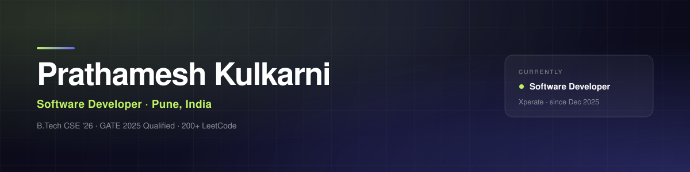

 

 

I'm a full-stack developer at **[Xperate](https://www.linkedin.com/company/xperate)**, building bespoke software for law firms, vendors and SME businesses. I work across **React, Angular, Node.js and .NET**, ship mobile apps in **Flutter**, and add machine learning where it actually earns its place.

 

## 🔨 Building right now

- **🧪 flakeguard** — an open-source CLI that finds the tests which randomly pass and fail, ranks them by how unreliable they are, and quarantines the known ones. Reads JUnit XML, TAP and Jest reports, so it works in any language.
  `Python` · `CLI` · `GitHub Actions` · MIT, published on PyPI — **[Read the repo](https://github.com/PrathameshKulkarni2k4/flakeguard)**

- **🎬 CineMatch** — a content-based movie recommender with a streaming-style UI. Ranks **4,806 titles** by content similarity across genres, keywords, cast and crew, with posters, official trailers and where-to-watch.
  `JavaScript` · `TMDB API` · `Cosine similarity` — **[▶ Open the live demo](https://prathameshkulkarni2k4.github.io/cinematch/)**

- **🧾 TiffinSplit** — a meal-cost sharing app that settles shared group expenses fairly, built type-safe end to end.
  `TypeScript` · `Next.js` · `MongoDB` — **[▶ Open the live demo](https://tiffinsplit.vercel.app)**

- **🏠 RoomBuddy** — a PG room-booking platform for students and owners, with real-time availability pushed over Socket.IO and JWT role-based access.
  `MongoDB` · `Express` · `React` · `Socket.IO` — **[▶ Open the live demo](https://roombuddyforstudent.vercel.app/)**

 

## ⭐ Selected work

| Project | What it does | Built with |
| :--- | :--- | :--- |
| **[Digipanchayat](https://github.com/PrathameshKulkarni2k4/AIRGSS-megaproject)** · [live](https://airgss-megaproject.vercel.app) | AI system automating citizen services for rural local bodies — NLP grievance classification and ML scheme-eligibility prediction | MERN · NLP · Computer Vision |
| **[Narratia](https://github.com/PrathameshKulkarni2k4/Narratia)** | Collaborative storytelling app — every writer drafts privately, then the drafts merge into one narrative with context-aware AI | Node.js · LLM APIs · MongoDB |
| **[MLOps Production Hub](https://github.com/PrathameshKulkarni2k4/mlops-production-hub)** | My MLOps track — reproducible pipelines for taking a model from notebook to production | Python · Make |
| **[shop_app](https://github.com/PrathameshKulkarni2k4/shop_app)** | A Flutter shopping app — hands-on work in mobile UI and state management | Flutter · Dart |

→ **[Browse all repositories](https://github.com/PrathameshKulkarni2k4?tab=repositories)**

 

## 🧰 Toolbox

**Languages**
     

**Frontend**
   

**Backend & data**
      

**Mobile**
 

 

## 🏅 Certifications

   

 

## 📈 Track record

 

**Open to talking about interesting problems, collaborations and good teams.**

<a href="mailto:prathameshkulkarni22092004@gmail.com">Email</a> &nbsp;·&nbsp; <a href="https://www.linkedin.com/in/prathameshkulkarni2k4/">LinkedIn</a> &nbsp;·&nbsp; <a href="https://prathamesh-kulkarni-portfolio.vercel.app/">Portfolio</a> &nbsp;·&nbsp; <a href="https://leetcode.com/u/PrathameshKulkarni2k4/">LeetCode</a>

